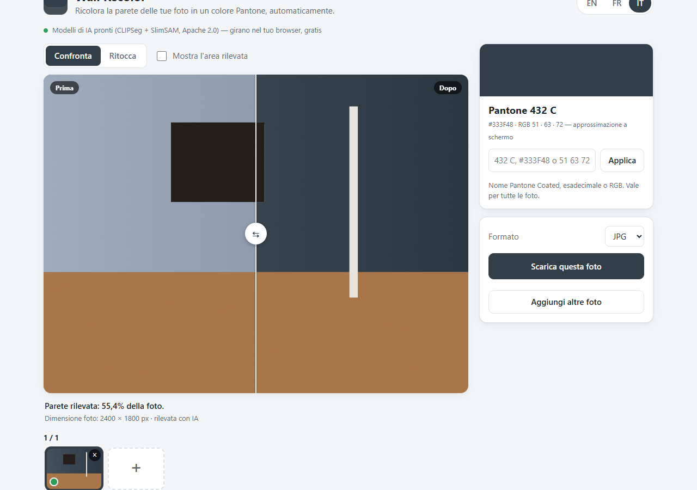

# Wall Recolor

Recolor the wall of a photo in any Pantone®, hex or RGB colour, directly in your browser.
Nothing is uploaded: the photos, the AI models and the rendering all stay on your computer.

**Try it:** https://bagareal.github.io/Wall-Recolor/



## What it does

1. Drop one or more photos (JPG, PNG, WebP, AVIF or TIFF, any size).
2. Two small AI models find the wall automatically; a colour model then refines the outline pixel by pixel. While a photo is being analysed you already see it, with a small pixel animation on the *After* side and the progress in the footer.
3. The wall is recoloured **while keeping the light**: shadows stay darker, lamp glow stays warmer, edges stay soft.
4. Compare before / after with a slider, touch up the selection if needed, and download the result at the photo's full resolution as JPG or PNG (single file or ZIP for a batch), or just the wall layer as a PSD to drop into your own Photoshop file.

The default colour is **Pantone 432 C** (`#333F48`). Type any other colour in the colour card:

| You type | Understood as |
| --- | --- |
| `432 C`, `Pantone 432C`, `cool gray 9` | a Pantone Coated name (partial built-in table, see `js/color.js`) |
| `#333F48`, `333f48`, `#3f4` | hex |
| `rgb(51, 63, 72)`, `51 63 72`, `51,63,72` | RGB |

You can also open the app with a colour in the URL: `index.html?color=185%20C` or `index.html?color=E4002B`.
The chosen colour is remembered in the browser and applies to every photo of the session. Exported files are named `photo-432C.jpg` (or `photo-E4002B.jpg` for a hex colour).

The **?** button at the bottom left explains supported files, export formats and colour profiles inside the app.

## Touch-up tools

| Tool | What it does |
| --- | --- |
| **Paint wall / Erase** | brush to add or remove wall, with size and hardness |
| **+ Area / − Area** | click a surface and the AI (SlimSAM) selects it whole, then adds it to or removes it from the wall |
| **Undo / Redo** | per photo, 30 steps |
| **Original (hold)** | shows the untouched photo while pressed |
| **Adjustments** | opacity of the new colour, saturation, brightness and contrast of the result (contrast deepens or softens the shadows on the wall) |
| **Show detected area** | pink overlay of the current selection |

Keyboard: `B` brush (Paint wall), `E` eraser, `+` / `−` add or remove an area (+ Area / − Area); these keys also switch to Touch up. In Touch up: `0` fit the photo, `Ctrl+Z` undo, `Ctrl+Shift+Z` / `Ctrl+Y` redo, hold `O` for the original, `[` `]` brush size, `Shift+[` `]` brush hardness, mouse wheel to zoom, hold `Space` or use the right mouse button to pan, `Ctrl` + right-drag to change the brush size (left/right) and hardness (up/down). In the photo strip: arrows to move, `Delete` to remove the focused photo.

The interface is dark-themed and available in English (default), French and Italian; switch language at the top right, the choice is remembered.

## Files and colour profiles

| | |
| --- | --- |
| **Open** | JPG, PNG, WebP, AVIF, GIF, BMP and TIFF, 8 or 16 bits per channel. PSD and HEIC files can't be opened: save a TIFF or JPG copy first. |
| **TIFF** | the flattened image is used (TIFF layers are not read, the file is never changed). 16-bit files are reduced to 8 bits; CMYK files are converted to RGB with approximate colours. |
| **Export** | JPG or PNG: the finished photo, 8 bits per channel. PSD: **only the wall layer**, the new colour with the wall as a layer mask and the chosen opacity (saturation, brightness and contrast already applied), at the photo's size and in its colour profile. In Photoshop, Shift-drag it into your own TIFF or PSD: it lands exactly in place and your layers are untouched. |
| **Colour profile** | each photo keeps its ICC profile (sRGB, Adobe RGB, Display P3, ProPhoto… any RGB matrix profile): the colour is applied in the photo's own profile and the profile is embedded in the export. The wall looks the same colour whatever the profile, but the RGB numbers depend on it (in an Adobe RGB photo, 432 C is not 51 63 72). Photos without a profile, and AVIF / GIF / BMP files, are treated as sRGB; CMYK, greyscale and lookup-table profiles are exported in sRGB, and the app says so when the photo is opened. |

## Privacy

Everything runs client-side. The only network requests are for the app files (the Lexend font is bundled), the [transformers.js](https://github.com/huggingface/transformers.js) library (from jsDelivr), the TIFF / PSD libraries (from jsDelivr, only when a TIFF is opened or a PSD is exported) and the AI models (from the Hugging Face hub, downloaded once and cached by the browser, about 155 MB in total). No photo, mask or colour ever leaves your machine.

## How it works

- **CLIPSeg** is asked for "a wall" and returns a coarse heat-map of where the wall is.
- **SlimSAM** (a compact Segment Anything model) cuts whole surfaces with precise outlines around the points where CLIPSeg is confident.
- A **tint model** learns the wall's chromaticity from the confident area and grows the mask through gradual lighting changes, stopping at real edges; a colour **guided filter** gives the final soft outline. Pieces of wall cut off by furniture are recovered by colour similarity.
- Recolouring happens in **CIE Lab**: the wall under ordinary light becomes exactly the target colour and every other pixel keeps its difference from it.
- Photos are opened in a Web Worker. Detection runs on a 1280 px sRGB working copy; the download is rendered at full size from the original file, decoded without colour conversion, recoloured in the photo's own ICC profile, with the mask re-snapped to full-resolution edges strip by strip.
- Without the AI models (offline, or an unsupported browser) the app falls back to a simple colour-based detection that only finds blue / grey-blue walls.

## Browser support

Made for desktop browsers with a mouse. Tested on Chrome and Edge; Firefox should work too. The app needs module Web Workers, `OffscreenCanvas` and `createImageBitmap` (any browser from 2023 on). Exports are limited by the browser's canvas size (about 50 megapixels / 16384 px per side; the app tells you when a photo is reduced). Phones and tablets show a notice and are not supported.

## Running it yourself

The app is static: `index.html`, `css/`, `js/` and `fonts/`. Any static web server will do (it must be served over HTTP, not opened as a file, because of the ES modules and the worker).

On Windows, **`start.bat`** starts a tiny PowerShell server on `http://localhost:8080` and opens the app; no installation needed.

### Optional: local AI models

When served from `localhost`, the app looks for the models in `./models/` first and only falls back to the Hugging Face hub if they are missing. To work fully offline, download these two repositories into that folder (the folder is ignored by git because the files are large):

```
models/
└── Xenova/
    ├── clipseg-rd64-refined/        https://huggingface.co/Xenova/clipseg-rd64-refined
    │   ├── config.json, preprocessor_config.json, tokenizer.json, tokenizer_config.json, special_tokens_map.json, vocab.json, merges.txt
    │   └── onnx/model_quantized.onnx
    └── slimsam-77-uniform/          https://huggingface.co/Xenova/slimsam-77-uniform
        ├── config.json, preprocessor_config.json
        └── onnx/vision_encoder_quantized.onnx, onnx/prompt_encoder_mask_decoder_quantized.onnx
```

The transformers.js library itself is still loaded from jsDelivr.

### Tests

The pure modules (colour maths and parsing, ICC profiles, file containers, image processing, detection, recolouring, ZIP writer, translations) have unit tests that run with Node 20+:

```
npm test
```

## Project layout

```
index.html        page markup
css/style.css     styles
js/app.js         UI, photo list, brush, undo/redo, export orchestration, info dialog
js/anim.js        pixel animation shown while a photo is analysed
js/worker.js      Web Worker: message loop, transformers.js inference, detection, SAM clicks
js/decode.js      opening photos in the worker (browser formats, TIFF) with their colour profile
js/exporter.js    full-size export: mask upscaling, recolouring in the photo's profile, JPG / PNG / PSD output
js/psd.js         wall layer PSD writer (colour + mask + opacity)
js/icc.js         ICC profiles: reading, colour spaces, a small sRGB profile
js/formats.js     file signatures, ICC profiles inside JPEG / PNG / WebP
js/libs.js        TIFF and PSD libraries, loaded on demand
js/detect.js      wall detection (CLIPSeg map + tint model + SAM + guided filter), colour fallback
js/recolor.js     Lab recolouring that keeps the light
js/imgproc.js     blur, connected components, morphology, guided filter
js/color.js       sRGB/Lab maths, colour parsing, Pantone table
js/zip.js         minimal ZIP writer
js/i18n.js        translations (en, fr, it)
fonts/            Lexend (SIL Open Font License, see fonts/OFL.txt)
tests/            node:test unit tests
serve.ps1, start.bat   local server for Windows
```

## Licences

Wall Recolor is released under the [MIT License](LICENSE).

It uses the following open-source components, loaded at run time:

| Component | Author | Licence |
| --- | --- | --- |
| [transformers.js](https://github.com/huggingface/transformers.js) (`@huggingface/transformers`) | Hugging Face | Apache-2.0 |
| [ONNX Runtime Web](https://github.com/microsoft/onnxruntime) (bundled in transformers.js) | Microsoft | MIT |
| [CLIPSeg](https://github.com/timojl/clipseg) `clipseg-rd64-refined` — ONNX conversion [Xenova/clipseg-rd64-refined](https://huggingface.co/Xenova/clipseg-rd64-refined) | Timo Lüddecke & Alexander Ecker (CIDAS, University of Göttingen) | Apache-2.0 |
| [SlimSAM](https://github.com/czg1225/SlimSAM) `slimsam-77-uniform` — ONNX conversion [Xenova/slimsam-77-uniform](https://huggingface.co/Xenova/slimsam-77-uniform) | Zigeng Chen et al. (NUS), based on Meta's Segment Anything | Apache-2.0 |
| [UTIF.js](https://github.com/photopea/UTIF.js) (`utif2` 4.1.0, TIFF decoding) | Photopea | MIT |
| [ag-psd](https://github.com/Agamnentzar/ag-psd) 33.0.0 (PSD writing) | Agamnentzar | MIT |

The interface uses the [Lexend](https://github.com/googlefonts/lexend) typeface by The Lexend Project Authors, bundled under the [SIL Open Font License 1.1](fonts/OFL.txt).

The photo in the screenshot is by [Katja Rooke](https://unsplash.com/@rooke) on [Unsplash](https://unsplash.com/photos/77JACslA8G0) (Unsplash License).

CLIPSeg also builds on OpenAI's CLIP (MIT). The guided filter follows He, Sun & Tang, *Guided Image Filtering* (2010).

PANTONE® and other Pantone trademarks are the property of Pantone LLC. The colour values in this app are common on-screen sRGB approximations and are not endorsed by or affiliated with Pantone; use official Pantone references for colour-critical work.
